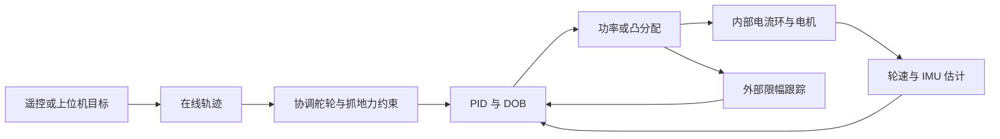

# Skywalker 下位机算法选型

研究资料核对日期：2026-10-08。本文结合当前工程、论文摘要、项目文档和公开源码提出下一阶段路线；自动整定及慢速 RLS 自适应已提供 C 接口，默认应用尚未接入，其他候选按下述条件推进。

## 范围与当前接口

算法规划限定在 H7 下位机，覆盖通用电机控制、云台执行控制、摩擦轮/拨弹、三种底盘、板载状态估计与滤波。遥控器、上位机和板间通信提供的目标作为外部输入。

选型以板端闭环收益、固定内存占用、可限定的计算量和现有接口的复用能力为依据。开发工具可以辅助离线推导、参数分析与仿真；运行算法的职责和部署目标均在下位机。

当前工程已经提供了一些可直接利用的接口：

- PID/DOB、跟踪微分器、低通/中值/陷波和 Kalman/IMU EKF 可作为通用算法基础。
- `app_protocol.h` 的 `VisionToGimbal` 已有 yaw/pitch 的目标角度、角速度、角加速度。默认云台任务为空，参考状态前馈需在应用中实现。
- `app_config.h` 的发射配置有摩擦轮转速、单发拨弹角、最大射频；默认 `ShootTaskLoop` 为空，摩擦轮恢复、拨弹时序和资源调度需在应用中实现。
- 裁判接口已有热量、冷却和弹速等字段，可以作为发射控制的观测/预算输入；使用时要按实际协议版本和数据更新率解释。
- CMSIS-DSP 提供 FFT，算法层有固定陷波接口；当前还没有板端频率跟踪和动态陷波闭环。
- 任务周期由 `app_config.c` 配置。算法使用静态对象，由应用任务直接调用和组合。

## 下位机候选与优先级

下面的优先级按当前接口的成熟度和复用范围排序。相对计算量是结构比较，不能用来替代 H7 实测用时。

| 领域 | 候选与用途 | 部署位置 | 优先级与前置条件 |
| --- | --- | --- | --- |
| 自动整定 | 积分RLS辨识、速度PI、位置外环及DOB验证；应用保存参数 | H7 C 接口 | 算法已实现；当前优先完成应用接入与真实机构验证 |
| 通用控制 | 两自由度 PID、速度/加速度模型前馈、外部限幅跟踪 | H7 算法层，所有电机机构复用 | 第一批；名义模型可先仿真，机械参数需整定 |
| 通用运动 | 三阶在线轨迹，输出位置/速度/加速度及 jerk 约束 | H7；云台、拨弹、舵向及底盘指令 | 第一批；已有轨迹接口可扩展 |
| 云台 | 参考状态前馈、基座运动补偿、小规模约束 MPC | H7 云台控制任务 | 先前馈再 MPC；明确目标/反馈坐标及机构动力学 |
| 云台进阶 | INDI 增量控制，使用角加速度响应修正输入 | H7 实验控制器 | 第二批对照研究；需要低噪声角加速度和有效执行器增益 |
| 发射机构 | 单发事件前馈、ILC 重复学习、摩擦轮能量恢复 | H7 发射任务，固定长度学习窗口 | 第二批；需要可重复单发事件和实际数据 |
| 发射调度 | 热量、轮速恢复与请求射频联合规划 | H7 小规模决策 | 可先做模型与时序仿真，参数依据实际规则和机构 |
| 全向/麦轮/舵轮 | 轮速/惯性融合、构型对应的动力学和凸分配 | H7 | 分构型建模；麦轮的横向滑动不能照搬舵轮摩擦模型 |
| 传感器与振动 | 频率跟踪、动态陷波、ESKF/鲁棒融合 | H7 滤波与估计层 | 根据反馈质量选择；振动处理需要验证谱峰来源 |
| 参数自适应 | 有界 RLS 机械参数估计、增益慢速更新和加速度前馈 | H7，固定尺寸状态与协方差 | 已接入整定流程；需要真实负载变化验证 |

两自由度 PID、前馈、ILC、INDI 和 ESKF 均有较长研究历史，属于有价值的算法选择，不能仅因接入工程就称为最新算法。较新的重点是 **2024 年 IML/DILC 的模型与控制联合学习研究** [R12]、**2025 年 Adaptive Caching** 和 **2026 年 Conic-TinyMPC**；它们分别对应重复动作学习与嵌入式约束优化。

## 通用控制：先统一参考状态和执行约束

建议将算法参考量组织成 `position / velocity / acceleration`，让轨迹、控制器和机构前馈共用。它适用于云台角度、拨弹位置、舵向角度和驱动轮速度控制，具体物理量保持现有 SI 接口约定。

两自由度 PID 可以分别调节设定值跟踪与扰动抑制：比例项对目标采用权重，微分仍使用反馈；模型前馈则根据目标运动计算所需转矩。它与现有 `kff` 对目标变化率的通用项作用不同。例如，转子侧机械前馈可包含：

```text
i_ff = (J_equivalent*alpha_ref + b*omega_ref + friction_ref + gravity_torque_ref) / Kt
```

各项必须转换到同一个转子侧坐标。基础模型描述已知运动需求，DOB 估计剩余扰动；增加前馈后仍需重新检查补偿限幅与瞬态，不能简单把多个估计都作为完整扰动叠加。

外部限幅跟踪也应是通用接口：功率分配、位置环输出的速度约束、执行器电流约束，都可以把实际可执行指令反馈给相应积分状态。详细推导见后面的底盘专题，其原理不限定于底盘。

## 云台执行控制

### 第一阶段：充分使用视觉参考状态

现有视觉协议已经提供目标角速度、角加速度。可以先研究：

```text
期望角度/角速度/角加速度
  -> 轨迹与机构限制
  -> 角度反馈 + 角速度反馈 + 加速度/重力前馈
  -> DOB 剩余扰动补偿
  -> 电流约束
```

这能减少高速跟踪时只能依靠位置误差产生驱动力的滞后。具体收益需用同一目标运动对照 PID/DOB 基线验证。

基座运动补偿也值得加入：底盘转动或倾斜时，需要区分云台关节坐标、IMU 机体系角速度与惯性系目标。即使限位只有约 30°，坐标投影、重力矩和惯量耦合仍可能影响控制；这里的理由是模型一致性和运动耦合。

### 第二阶段：约束 MPC 与 INDI 对照

云台小规模 MPC 可将 yaw/pitch 的角度、角速度作为状态，以机构转矩/电流为输入，考虑角度、速度和电流限制，并利用未来参考角速度/加速度。TinyMPC 与 Conic-TinyMPC 的移植条件同样适用，不限于底盘。

INDI 则根据观测到的角加速度和上一有效输入，计算输入增量。单轴示意为：

```text
delta_current ~= J/Kt * (alpha_requested - alpha_observed)
current_new = previous_effective_current + delta_current
```

完整实现需要过滤后的输入/响应保持一致的动态关系，并处理轴间耦合与执行器响应。角加速度通常来自陀螺仪角速度估计/微分，噪声是主要代价。Paparazzi 有公开的 INDI、滤波与控制效能估计实现可供核对 [R9]。其飞行器实现不能直接当作云台控制器，需要与当前 PID/DOB 做同模型对照，选择合适方案。

MPC 在这里预测的是云台自身的角度、角速度和输入响应。目标状态由外部接口给出，板端负责参考状态的机构坐标转换、限幅、插值与闭环跟踪。

## 发射机构

### 单发事件前馈和重复学习

摩擦轮发射后的转速下降、拨弹盘的固定行程，是较好的重复动作学习对象。可以先记录单发窗口中的轮速误差与输入，再建立事件前馈；之后评估 ILC：

```text
u_ff_next_trial[n] = Q_filter(u_ff_trial[n] + L_filter(error_trial[n]))
```

ILC 沿“第几次重复动作”学习，不是每个控制周期无条件增大增益。射频、初始轮速、弹丸和供弹负荷变化时，重复性会变化，因此应按工况评估。学习项与反馈/DOB 共用最终电流限幅。

2006 年 ILC 综述可作为理论入口 [R11]；2024 年 IML/DILC 预印本研究未知模型与控制输入的联合迭代学习 [R12]。把它用于 RoboMaster 单发恢复是这里提出的应用方向，引用论文没有证明本机器人的发射效果。

### 能量恢复与发射规划

相比固定射频，可以根据摩擦轮可用动能、恢复能力、热量冷却和请求射频规划下一次拨弹。基础能量模型为：

```text
wheel_energy = sum(0.5*J_i*omega_i^2)
heat_next = heat - cooling*dt + heat_per_shot*shot_count
```

弹丸取得的能量、滑动和机构损耗需要辨识，不能只由轮速精确推出弹速。裁判系统弹速反馈可以用于慢速模型修正；是否能用于逐发闭环取决于实际消息频率和对应关系。

这类规划的目标是表达射频、恢复和热预算之间的权衡。发射次数是离散变量，小规模可枚举有限候选；将射频连续松弛后还需转换为拨弹事件。标准连续 TinyMPC 不直接解决完整的离散发射调度问题。

## 振动与状态估计

动态陷波可用于云台角速度、摩擦轮引起的 IMU 振动以及其他机构反馈。PX4 的公开实践同时使用转速反馈和板端 FFT 跟踪频率 [R10]，值得借鉴。

可以先记录反馈并离线检查频谱，再研究按有效转速信息或缓慢更新的谱峰调整陷波中心。需要确认它滤掉的是振动成分：目标周期运动、正常旋转和结构振动均可能产生峰值，不能把最大峰自动当作要消除的噪声。滤波效果同时评价噪声与相位延迟。

ESKF 的价值是统一姿态、传感器偏置、速度及多源观测的误差状态表达 [R14]。选型依据是融合需求、误差传播和偏置估计。板端按实际传感器配置研究轮速/IMU融合，采用固定尺寸状态与工作区；没有独立观测时的共同滑移和漂移限制仍然存在。

## 各构型底盘执行控制

- **全向轮、麦轮**：固定轮运动学已有基础，下一步关注轮速/IMU融合、速度与电流约束、传动及地面损耗、车体运动和云台补偿的协调。麦轮有特殊横向滚动/滑动特性，附着模型与四舵轮不同。
- **舵轮**：进一步关注轮向选择、抓地力、舵向动态和冗余轮力分配，详细分析保留在下方专题。
- **外部控制来源**：手动控制与哨兵均复用板端速度跟踪、运动学和电流控制链。算法接收外部车体目标，关注本车响应与执行约束。

共享的是参考状态、估计接口、优化工作区和执行约束；各构型使用自己的观测矩阵和动力学。不能把一个构型的轮胎模型统一套用给其他构型。

## 板端参数自适应

当前已有固定尺寸积分RLS，使用实际电流与角速度辨识电流坐标模型，避免直接微分。完整实现及使用见 [板端自动整定](autotune.md)。其连续模型为：

```text
current = (J/Kt)*angular_acceleration + (b/Kt)*omega + friction_current + load_current
```

辨识后自动计算速度PI，并根据已闭合速度环的响应整定位置外环；DOB完整补偿链再验证。在线更新要求近期动态激励、模型质量及惯量范围，并限制增益变化速度。已完成模型仿真及ARM机器码验证，真实闭环数据仍需核对输入相关性、负载变化及共振影响。

当前前馈只补偿名义加速度需求，积分/DOB处理摩擦及剩余负载。应用可将结果保存为 C 配置，重新编译固件后恢复模型；运行中的更新频率低于反馈/DOB更新频率。

## 下位机推进顺序

1. **自动整定与自适应实测**：在驱动轮、云台/舵向及发射机构验证已有板端流程，减少人工增益试验。
2. **通用控制与机构策略**：参考状态、轨迹、云台动态跟踪、摩擦轮恢复/拨弹时序和各底盘执行约束。
3. **专项实验**：动态陷波、云台 INDI、发射 ILC，以合成数据和机构模型先做对照。
4. **约束优化**：先小规模凸分配，再分别评估云台/底盘 TinyMPC，以及适合板端的锥约束。
5. **自适应扩展**：按工况评价在线模型迁移和重复学习；IML/DILC 需进一步核对计算与存储需求。

实测前可完成算法推导、接口设计、静态工作区、应用调用、合成数据和非线性仿真。增益、附着/惯量/摩擦、重复学习参数、振动频段以及 H7 用时依然需要对应机构的数据。

## 专题：舵轮与底盘约束优化

### 当前基础与下一步

工程已有 PID/DOB、三次余弦修正、四轮协调目标、名义轮速加速度和舵向速度限制、轮速最小二乘估计、统一电流功率缩放、五次轨迹，以及参数辨识和 DWT 计时的 C 接口。完整机构控制链由应用组合。

对应代码：

- `Skywalker/Algorithm/Src/alg_motion.c`：目标约束、固定时长五次轨迹、功率模型、轮速反算。
- `Skywalker/Algorithm/Src/alg_dob.c`：电机转子侧扰动观测。
- `Skywalker/Algorithm/Src/alg_pid.c`：PID 内部限幅与抗积分饱和。
- `Skywalker/Algorithm/Src/alg_kinetics.c`：三种底盘运动学与舵轮三次余弦修正。
- `Skywalker/BSP/Src/bsp_profile.c`：DWT 周期计时。

建议按以下顺序推进。成本是算法结构的比较，没有 H7 实测用时。

| 顺序 | 候选 | 解决的问题 | 相对当前实现的增量 | 实测前可以完成 |
| --- | --- | --- | --- | --- |
| 1 | 外部限幅跟踪与控制器协调 | 功率分配后的电流缩小，PID 积分仍可能继续增加 | 将已有执行指令跟踪接口接入完整控制链 | 饱和仿真、应用调用 |
| 2 | 抓地力约束舵轮目标生成 | 急转弯、急加减速时的纵横向附着限制 | 约束轮胎受力和电机转矩，不仅约束轮速变化 | 刚体模型、参数接口、离线约束测试 |
| 3 | Ruckig 类三阶在线轨迹 | 固定时长五次轨迹没有硬性加速度/jerk 保证 | 按速度、加速度、jerk 上限实时重规划 | 标量/多轴仿真、边界和重规划验证 |
| 4 | 鲁棒轮速/IMU 估计 | 单轮异常对等权最小二乘的影响 | 分轮创新、鲁棒权重、惯性预测 | 合成滑移、偏置和噪声试验 |
| 5 | 小规模 QP 电流/转矩分配 | 全轮统一缩放无法表达平移与旋转优先级 | 优化各轮电流，显式考虑可实现车体力 | 凸性推导、求解器原型、约束测试 |
| 6 | TinyMPC / Conic-TinyMPC | 未来速度/轨迹与执行约束的联合优化 | 短预测时域，进一步支持锥约束 | 模型、PC 仿真、静态工作区和 ARM 编译 |

1 和 4 属于成熟控制/估计方法在当前工程中的补齐；3 是现代成熟工具；6 的 2025/2026 年扩展属于较新的嵌入式优化研究。

### 1. 先让功率分配与 PID 协调

现有 PID 会判断自己的 `output_max`。应用随后叠加 DOB，再通过功率预算缩小电流时，PID 内部的限幅判断看不到这次外部削减：即使内部输出未饱和，功率预算也可能已经让电机无法执行请求。已有 `PidTrackOutput()` 接口，应用需传入最终执行量与总请求之差。

执行量跟踪采用 tracking anti-windup。用积分输出 `I` 表示积分状态，示意更新为：

```text
I_next = clamp(I + Ki*error*dt + Kaw*dt*(i_final - i_requested))
```

这里 `i_requested` 是包含 DOB/前馈、进入最终分配前的总电流请求，`i_final` 是最终将发送的电流指令。二者在同一个转子电流坐标中比较。这样在没有外部削减时，跟踪项为零；发生功率限制时，积分会朝可执行电流收敛。

这项输入采用最终限幅后的指令。实际反馈电流仍用于 DOB 和机械模型，不能直接与另一个周期的请求混合成同一外部限幅差。实现还需处理 `Ki=0` 和位置/速度串级的单位关系。

第一项离线对照：持续给出超出功率预算的速度目标，随后降低目标或释放预算，比较积分峰值、恢复超调和恢复时间。这不需要真实电机才能验证控制器逻辑。

### 2. 抓地力约束目标生成

PathPlanner 的舵轮目标生成器提供了贴近竞赛机器人的参考 [R1]：它考虑电机最大转矩、轮胎与地面的摩擦、舵轮转动造成的横向力，以及模块内部摩擦。

当前 `SteerSetpointUpdate` 限制标量轮速变化和舵向目标变化。下一步应同时考虑每个接触点的纵向与横向负荷：

```text
sqrt(F_long_i^2 + F_lat_i^2) <= mu_i * Fz_i
```

急转弯时，即使轮速大小几乎不变，横向负荷仍可能很大。刚体轮心加速度可写为：

```text
a_i = a_center + yaw_acceleration * J*r_i - yaw_rate^2 * r_i
J = [[0, -1], [1, 0]]
```

各量都在当前车体系表达，`a_center` 是质心的惯性加速度在车体系中的表达；若由车体系速度导数计算它，还需加上坐标旋转项 `yaw_rate * J*v_center`。

工程接入位置：统一轮速限幅之后、三次余弦修正之前，延续现有四轮共同插值。电机能力来自电流/转矩限制；地面能力来自有效附着系数及法向载荷估计。

第一版可采用对称底盘、静态载荷分配和配置的有效附着系数。它是简化模型，载荷转移、地面变化和侧向轮胎特性需要后续数据验证。不能把固定 `mu` 描述成实时检测到的抓地力。

可离线比较直行加速、平移同时旋转、快速换向，以及不同初始舵角下的起步。目标是检查预测受力和轮速/舵向约束，并量化目标响应延迟。

### 3. 带 jerk 上限的在线轨迹

Ruckig 的 RSS 2021 论文给出了从任意初始位置、速度、加速度到完整目标状态的在线轨迹生成，显式限制速度、加速度和 jerk，并支持多轴同步 [R2]。

当前五次轨迹在重规划时保持位置、速度和加速度连续，但时长由配置指定。相同时间内移动更远，所需峰值加速度和 jerk 会增大；它没有自动按这些上限选择时长。

适合的接入方式：

- 舵向和云台：位置模式，输入连续角度、角速度和角加速度；先完成角度选向，再使用连续角度目标。
- 底盘指令：速度模式，限制车体速度、加速度及加速度变化率，再进入协调舵轮目标生成。
- 多轴同步：在确实需要同时完成动作时使用。三个车体分量各自满足限制，不代表每个轮子的约束也满足；后续四轮约束仍有作用。

Ruckig 当前主分支使用 C++20 和 `double`。其 CMake 默认启用 cloud client，嵌入式状态到状态规划应显式关闭这一选项 [R3]。原库通过 C 接口适配或移植标量算法均可评估；不能把简化的 jerk 变化率限制器称为完整 Ruckig 或宣称时间最优。

### 4. 鲁棒轮速与惯性估计

当前反算采用等权轮速方程及可选陀螺仪权重。某个轮子瞬时空转或反馈偏离时，等权估计会受到影响。轻量改进可以采用逐轮残差和 Huber 损失，通过固定少量 IRLS 迭代降低异常轮的影响。

舵轮的两条方程来自同一个速度/角度观测，应按模块处理残差或建模它们的相关性，不能当作完全独立的两份传感器数据。与 IMU 的融合可采用带加速度偏置的预测及轮速更新，噪声权重需整定。

边界必须保持明确：

- 单轮异常相对于其他轮和陀螺仪有时可辨别。
- 多轮共同滑移可能仍满足运动学关系，残差很小。
- IMU 能提供短期运动约束，恒速共同滑移与真实速度仍可能不可区分，不能宣称仅靠轮速/IMU 就能持续准确恢复绝对速度。

板端估计优先使用现有轮速和 IMU，保留逐轮残差与整体一致性指标。是否引入鲁棒权重应通过异常轮与正常快速运动的对照验证，避免正常动态被持续降权。

### 5. 从统一缩放走向小规模凸分配

当前功率限制为全轮电流统一缩放。可以改为四个驱动电流的优化问题，用任务权重表达“当前动作更重视车体旋转还是平移”。

固定当前舵角时，沿轮子滚动方向的力到车体力/力矩的映射为：

```text
w = G(theta) * f
w = [Fx, Fy, Mz]^T
G_i = [cos(theta_i), sin(theta_i), x_i*sin(theta_i)-y_i*cos(theta_i)]^T
```

例如目标函数：

```text
min ||W*(G*f - w_requested)||^2
    + lambda_loss * sum(copper_loss_i * current_i^2)
    + lambda_change * ||current - previous_current||^2
```

约束包含电流上下限、变化率、附着和总功率。`f` 与电流的关系应包含减速比、效率，并根据精度需求处理转子/车轮加速用去的转矩；不能在强加速时始终把全部电机转矩当作接触力。

这个映射只描述主动纵向轮力。所有轮子平行时，`G` 的横向力行退化，固定舵角下并不能独立产生任意三自由度力。优化器应允许未实现的需求误差，并与舵向目标生成配合；侧向接触力还需要额外轮胎模型。

在当前轮速固定、损耗系数为正的功率模型下：

```text
sum(max(a_i*current_i^2 + b_i*current_i, 0)) <= available_power
b_i = Kt_i * rotor_omega_i
```

这是凸约束，但不是只有线性约束的标准 QP。第一版可用保守线性近似做 QP；保留完整表达时则需要凸二次约束或锥建模。

### 6. 真正值得研究的嵌入式 MPC

#### TinyMPC：基础版本

TinyMPC 的 ICRA 2024 论文将 ADMM 与 MPC 结构、矩阵预计算结合，展示了微控制器上的闭环应用 [R5]。这构成值得评估的嵌入式实现证据；论文中的其他平台性能不能作为本工程 H7 的耗时。

起点可以是车体速度状态 `x=[vx,vy,yaw_rate]`，用短时域预测速度响应及输入约束。RoboMaster 需要兼顾底盘与云台/发射任务，可以先研究 100–200 Hz、10–20 步的外层原型；这些数字是仿真起点，最终频率和时域需要 DWT 测量决定。

机械模型继续采用内部电流环较快的近似。若候选控制带宽接近实际内环动态，再引入有效转矩滞后；没有必要一开始把完整电气状态放进模型。

基本动力学在车体系可表示为：

```text
m*(dvx/dt - yaw_rate*vy) = Fx
m*(dvy/dt + yaw_rate*vx) = Fy
Iz*dyaw_rate/dt = Mz
```

每台电机的 DOB 不能直接视为已经提供完整车体扰动力/力矩估计。若 MPC 使用车体扰动状态，需另做映射和可观性分析。

#### Adaptive Caching：IROS 2025

[R6] 用缓存对求解器超参数的敏感度，降低在线调整参数时的重计算成本。它主要调整 ADMM 的 `rho`，不等同于在线更新底盘质量、惯量或摩擦系数，也不直接解决舵角变化造成的 `B(theta)` 更新。

当前公开 `tiny_api.cpp` 明确写有 `Adaptive rho currently supports only quadrotor system`，初始化敏感度使用 4 输入/12 状态的示例数组 [R8]。因此舵轮模型需要重新生成相应缓存及敏感度，不能直接打开该开关就认为适配完成。

#### Conic-TinyMPC：ICRA 2026

[R7] 加入二阶锥约束和代码生成，是与轮胎摩擦圆、功率约束最相关的新扩展。

功率模型可先引入辅助变量：

```text
t_i >= a_i*current_i^2 + b_i*current_i
t_i >= 0
sum(t_i) <= available_power
```

经过尺度归一化后，二次上图约束可写成旋转二阶锥，并转换成标准二阶锥。然而某个求解器支持锥，并不代表其现有 API 支持任意这样的模型；仍需确认辅助变量、仿射变换和与 MPC 输入状态的组织方式。

#### 在本工程中的移植条件

公开主分支 `types.hpp` 使用 Eigen 动态矩阵与 `double`，`tiny_setup` 有 `new`，CMake 使用 C++17 [R8]。与现有静态工作区 C 算法不同，应把以下内容当作实际移植工作：

1. 固定状态/输入/时域尺寸，提前分配工作区，检查控制循环中临时矩阵的分配。
2. 通过 C 接口对接应用，并评估当前禁止 RTTI、异常的工具链设置。
3. 模型改变时检查缓存是否仍有效。动态舵角造成的输入矩阵变化需要重计算、分区缓存或不同模型组织，不能沿用错误缓存。
4. 每次求解记录迭代数、残差、约束违反量和实际用时。迭代上限提供计算量限制，不等于证明返回解已满足所有约束。
5. 第三方求解器的开发依赖按候选模块接入，基础固件保持现有 CMake、Ninja 和 ARM 工具链构建流程。

### 底盘专题推进与验收

推荐近期组合：**外部限幅协调 + 抓地力约束目标生成 + 三阶在线轨迹**。之后用鲁棒估计和四输入凸分配建立 MPC 所需的状态与执行约束，再评估 TinyMPC，最后研究锥约束和自适应缓存。



先用同一离线模型比较基线与候选：目标响应、积分恢复、轮胎预测负荷、估计误差、求解残差和约束违反量。实车阶段再整定附着/功率/机械参数、核对内环近似、测量 H7 时序，并检查真实跟踪和滑移。没有依据时不预设性能提升百分比。

## 来源

| 编号 | 来源及核对范围 |
| --- | --- |
| R1 | [PathPlanner Swerve Setpoint Generator](https://pathplanner.dev/pplib-swerve-setpoint-generator.html)：官方文档中转矩、摩擦、横向力和目标生成描述 |
| R2 | [Jerk-limited Real-time Trajectory Generation with Arbitrary Target States](https://arxiv.org/abs/2105.04830)，RSS 2021：摘要；[Ruckig 官方文档](https://docs.ruckig.com/) |
| R3 | [Ruckig CMakeLists](https://github.com/pantor/ruckig/blob/main/CMakeLists.txt)、[ruckig.hpp](https://github.com/pantor/ruckig/blob/main/include/ruckig/ruckig.hpp)：公开源码，C++20、cloud client 默认值和数据类型；CMake 文件 blob SHA `9271f7c871c65026bde0b433c94e4ccc1de01553` |
| R5 | [TinyMPC: Model-Predictive Control on Resource-Constrained Microcontrollers](https://arxiv.org/abs/2310.16985)，ICRA 2024：摘要；[模型](https://tinympc.org/get-started/model/)与[求解器文档](https://tinympc.org/solver/background/) |
| R6 | [Robust and Efficient Embedded Convex Optimization through First-Order Adaptive Caching](https://arxiv.org/abs/2507.03231)，IROS 2025：摘要与官方项目书目 |
| R7 | [Code Generation and Conic Constraints for Model-Predictive Control on Microcontrollers with Conic-TinyMPC](https://arxiv.org/abs/2403.18149)，ICRA 2026：当前论文摘要及官方项目书目；[代码生成文档](https://tinympc.org/get-started/examples/) |
| R8 | [TinyMPC types.hpp](https://github.com/TinyMPC/TinyMPC/blob/main/src/tinympc/types.hpp)、[tiny_api.cpp](https://github.com/TinyMPC/TinyMPC/blob/main/src/tinympc/tiny_api.cpp)、[CMakeLists](https://github.com/TinyMPC/TinyMPC/blob/main/CMakeLists.txt)：GitHub API 取得公开源码。`types.hpp` blob SHA `9bf8eff2df419163693ec6fcab7f7799611e8408`；`tiny_api.cpp` blob SHA `9db0da937b57297d14ffc1100d97f9c4e1c90edb` |
| R9 | [Paparazzi INDI 实现](https://github.com/paparazzi/paparazzi/blob/master/sw/airborne/firmwares/rotorcraft/stabilization/stabilization_indi.c)：GitHub API 取得公开源码，核对滤波、控制效能与增量实现；未在云台复现 |
| R10 | [PX4 Filter Tuning](https://docs.px4.io/main/en/config_mc/filter_tuning)：官方文档的动态陷波、转速/FFT 频率来源及延迟权衡 |
| R11 | [A survey of iterative learning control](https://doi.org/10.1109/MCS.2006.1636313)，IEEE Control Systems Magazine 2006：Crossref 核对书目，作为成熟 ILC 的理论入口 |
| R12 | [Iterative Model Learning and Dual Iterative Learning Control: A Unified Framework for Data-Driven Iterative Learning Control](https://doi.org/10.36227/techrxiv.171779307.75035853/v1)，2024 预印本：Crossref 核对书目和摘要；不视为 RoboMaster 发射机构实证 |
| R14 | [Quaternion kinematics for the error-state Kalman filter](https://arxiv.org/abs/1711.02508)，Joan Solà：摘要，误差状态和 IMU 估计理论入口 |

论文的效果属于其模型、平台和试验范围。上述排序来自它们与当前工程接口和比赛任务的匹配分析，不代表这些方法已经在本机器人上验证。
