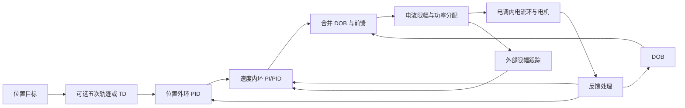

# 算法清单与组合说明

按 2026-10-24 当前工作区源码整理。算法层共有 20 组 `alg_*.h/.c` 模块；一个模块可能包含多种算法，例如 `alg_motion` 同时包含轨迹、舵轮目标生成、功率约束与车体速度估计。

本文说明源码中已提供的能力。新增 SIFt-RLS、PI 性能优化和单电机帕累托整定属于 2.0 实验扩展。其余模块也不因列入清单而代表已在所有机构上完成实机验证。

## 工程组织

| 位置 | 当前职责 |
| --- | --- |
| `Core/`、`Drivers/`、`Middlewares/` | STM32 初始化、HAL/CMSIS、CMSIS-DSP 和 FreeRTOS |
| `Skywalker/BSP/` | 通信、流缓存、计时和外设封装 |
| `Skywalker/Device/` | 设备反馈与指令，以及 DJI 级联控制、BMI088 姿态处理等设备封装 |
| `Skywalker/Algorithm/Inc/`、`Src/` | 通用算法声明与实现 |
| `Skywalker/Application/` | 配置、机器人任务、控制链组合和通信协议 |
| `docs/` | 结构、应用接口、算法清单与整定说明 |

当前 `app_robot.c` 的管理、云台、底盘、发射任务循环均为空。算法库提供能力，应用决定哪些模块实际运行。详细分层见 [Framework 结构说明](framework-guide.md)。

## 一、反馈控制与扰动补偿

| 模块 | 算法与用途 | 主要接口 |
| --- | --- | --- |
| `alg_pid` | 并联 PID，可配置为 P、PI、PD。用于电机速度环、位置外环及温控等标量闭环 | `PidInit`、`PidCalculate`、`PidReset` |
| `alg_dob` | 一阶 Q 滤波的扰动观测器。根据实际转矩电流和转子速度估算等效负载，输出补偿电流 | `DobInit`、`DobUpdate`、`DobReset` |

### PID 当前包含的机制

- 梯形误差积分。
- 可选微分先行，对反馈微分以减少目标阶跃带来的微分冲击。
- 可选目标变化率前馈 `kff`，不等同于完整动力学前馈。
- 条件积分、积分限幅，以及误差过零时的积分衰减。
- 可选积分分离和输出死区，最终输出限幅。
- `PidSetGains()` 通过调整积分状态尽量保持改参时的当前输出。
- `PidTrackOutput()` 根据外部限幅前后的输出差修正积分。

应用应配置正的输出限幅。`integral_max` 是误差积分上限；积分输出预算为 `I_max` 时，应按 `I_max / Ki` 换算。

### DOB 的角色

核心为 `Q(s)[Kt*i - J*s*ω]`。惯量统一折算到转子侧：`J_motor + J_load / reduction_ratio²`。它补偿名义惯性模型之外的摩擦、负载及其他等效扰动，不直接调整 PID 增益。

输入是实际反馈电流和转子角速度，输出为限幅后的补偿电流。内部电流环由电调封装；当前机械层控制使用内电流环相对较快的近似。

## 二、目标平滑、微分与反馈滤波

| 模块 | 算法与用途 | 主要参数与输出 |
| --- | --- | --- |
| `alg_td` | 线性二阶跟踪微分器，以临界阻尼形式跟踪输入，同时给出平滑信号和微分估计 | `r`、`dt`；输出 `x1`、`x2` |
| `alg_td_nl` | 非线性跟踪微分器，包含 `Fhan` 分段综合函数实现 | `r`、`h`、`dt`；输出 `x1`、`x2` |
| `alg_lpf` | 一阶低通与二历史输出的二阶递推平滑 | `alpha` 或 `alpha_1/alpha_2`；输出滤波值 |
| `alg_median` | 固定 5 点窗口中值滤波，主要用于抑制孤立尖峰 | 输出窗口中值 |
| `alg_notch` | 二阶递归滤波结构，提供按中心频率和品质因数配置的陷波接口 | `f0`、`Q`、`fs`；输出滤波值 |

一阶低通实现为 `y = alpha*x + (1-alpha)*y_previous`，因此 alpha 越小，平滑越强、响应越慢。二阶实现为 `y = alpha_1*x + alpha_2*y[n-2] + (1-alpha_1-alpha_2)*y[n-1]`，不是自动按截止频率设计的 Butterworth 接口。

TD 主要用于同时获得平滑参考与其变化率；低通、中值和陷波主要用于反馈处理。它们都可能引入延迟，应用按信号和频段选用，不要求全部串接。

## 三、状态估计与姿态数学

| 模块 | 算法与用途 | 当前实现边界 |
| --- | --- | --- |
| `alg_kf` | 通用线性 Kalman 滤波器，提供预测、观测更新及合并单步 | 应用配置 F/B/H/Q/R/P；基于 CMSIS-DSP；工作区由调用方提供，可使用静态数组 |
| `alg_imu_ekf` | IMU 扩展 Kalman 滤波器，融合三轴陀螺和加速度 | 6 状态：roll/pitch/yaw 与三轴陀螺零偏；使用欧拉角状态 |
| `alg_quaternion` | 四元数乘法、归一化、欧拉角转四元数 | 姿态数学工具，本身不做传感器融合 |
| `alg_euler` | 四元数转欧拉角，以及欧拉角/角速度数据结构 | 表达和转换工具，本身不做滤波 |

IMU EKF 用角速度进行姿态预测，用加速度的重力模型修正姿态与相关零偏。当前没有磁力计或独立航向观测，yaw 没有绝对方向基准；明显的平移加速度也会影响重力观测。这属于传感器与观测模型的能力范围。

BMI088 驱动已组合此 EKF，并输出姿态、欧拉角速度和估计陀螺零偏。

## 四、底盘运动学与运动约束

### `alg_kinetics`：三种底盘运动学

当前文件名为 `kinetics`，实现内容是底盘运动学（kinematics），不包含完整车体动力学。保留现有文件名与 API。

| 构型 | 输入 | 输出与特点 |
| --- | --- | --- |
| 全向轮 | `vx/vy/omega` 和半轮距 | 四轮线速度，按现有轮序及安装方向分解 |
| 麦轮 | `vx/vy/omega` 和半轮距 | X 型辊子布局下的四轮线速度 |
| 舵轮 | `vx/vy/omega`、半轮距和可选实际舵角 | 四轮速度及舵角，超过 90° 时翻转驱动方向以减少转向；零速保留舵角 |

公共接口为 `ChassisInit()`、`ChassisSetParams()`、`ChassisSetVelocity()`、`ChassisUpdateState()`。公共轮序为左前、左后、右后、右前；x 向前、y 向左、逆时针 omega 为正。

### `alg_motion`：七项运动与执行计算

| 功能 | 接口 | 作用与边界 |
| --- | --- | --- |
| 标量变化率限制 | `MotionRampUpdate` | 分别限制上升、下降速度，可用于速度、电流或其他标量目标 |
| 五次轨迹 | `MotionTrajectoryReset/Update` | 在指定时长内到达目标并静止，输出位置/速度/加速度；目标变化时从当前状态重规划，保持这三项连续。没有显式 jerk、速度或加速度上限求解 |
| 四舵轮协调目标生成 | `SteerSetpointReset/Update` | 在车体速度之间插值，按四轮轮速加速度和舵向速度筛选可行目标，带选向滞回及静止预转向。约束的是目标，不是实际轮胎附着 |
| 三次余弦轮速修正 | `SteerSpeedCorrect` | 根据目标舵角与实际舵角的误差衰减驱动轮速，保留速度符号；通过参数 a 调节衰减强度 |
| 电机功率估计 | `MotorPowerEstimate` | 累加 `max(k_i*i² + Kt*ω*i, 0)`，不把回馈功率抵扣为可用预算 |
| 功率预算电流缩放 | `MotorPowerScale` | 二分求所有电流统一的缩放比例，不做各轮优先级优化或凸分配 |
| 车体速度反算 | `ChassisEstimateVelocity` | 用四轮反馈构建最小二乘问题，可加入加权陀螺约束，输出 `vx/vy/omega` 和整体残差。不是完整轮速/IMU 时序融合器 |

### 三次余弦修正的调用位置

对每个轮子计算最短角度误差，角度均为 rad：

```text
δ = wrap(target_angle - actual_angle)
φ = min(a * abs(δ), π/2)
speed = target_speed * max(cos(φ), 0)³
```

`a` 为非负可调参数：1 使用原始误差，0 不衰减；越大越早抑制轮速。角度参数在 π/2 截断，防止大误差时余弦周期性恢复驱动力。修正不改变目标舵角，反向驱动的轮速仍保持负值。

应用在 `ChassisUpdateState()` 或 `SteerSetpointUpdate()` 之后调用，使用实际舵角，输出到独立的驱动速度数组。不要将修正后的轮速写回 `SteerSetpoint.wheels`；该对象保留协调规划目标，避免重复衰减和干扰下一周期的约束计算。

调用示例见 [应用开发](manual-application.md#舵轮驱动速度修正)。

## 五、辨识、自动整定与参数优化

| 模块 | 算法与用途 | 当前范围 |
| --- | --- | --- |
| `alg_sysid` | 固定四参数积分辨识；支持指数遗忘 RLS 和可选 SIFt-RLS | 辨识等效惯性、黏性、库仑摩擦与恒定负载；SIFt 是 2.0 实验扩展 |
| `alg_autotune` | 单电机主动整定，按模型生成速度 PI，再验证位置外环和 DOB；支持正常运行慢速自适应 | 可选调用 PI 性能优化；应用负责控制权、执行、反馈与结果保存 |
| `alg_motor_tune` | 复用基准整定，测量方向、低速、换向、保持特征；搜索带宽、阻尼比和前馈比例，按性能约束筛选并独立验证 | 板端最多 27 个候选，输出已测候选中的完整帕累托集合与 PID 配置；参数随负载/姿态变化的函数拟合尚未加入 |
| `alg_pid_tune` | 借鉴 DiffTune+ 的低维敏感度优化，根据真实测试损失优化两个 PI 增益 | 2.0 实验扩展；当前限于受支持的纯 PI，不联合优化位置、DOB 和滤波器 |
| `alg_chassis_tune` | 底盘落地流程，整定角速度外环并统计前向/横向响应 | 三种底盘共用，可选 SIFt 和 PI 优化；不是所有轮子、所有车体控制参数的联合整定 |

### 1. 积分 RLS / SIFt-RLS

机械模型使用控制反馈坐标：

```text
i = M*dω/dt + B*ω + F*direction(ω) + L
M = J/Kt，B = b/Kt
```

对采样窗口积分后辨识，避免直接差分速度。模型输出包含拟合度和有效窗口数，读取模型还要满足动态激励等条件。

普通指数遗忘折减所有方向的历史信息；SIFt 只沿当前观测的信息方向遗忘。当前 SIFt 为标量观测的四维实现，使用 double 信息矩阵和 Cholesky 求逆，不引入通用 SVD。弱激励方向的信息保留不意味着该方向已经被辨识，也不保证参数变化后收敛更快。

### 2. 模型整定与慢速自适应

速度 PI 初值由自然频率生成，主要关系为 `Kp = 2*ωn*M - B`、`Ki = M*ωn²`，实现还包含可用增益及带宽限制。

主动整定输出测试电流，按速度、可选位置、可选 DOB 顺序验证。正常自适应则使用运行中的实际电流与速度，缓慢更新模型和增益，并返回名义加速度前馈增量。摩擦与剩余负载继续由积分/DOB 处理。

### 3. PI 闭环性能优化

`alg_pid_tune` 在对数增益坐标传播机械响应及 PI 状态敏感度，累计跟踪误差、输出和输出变化的归一化代价，按二次近似选择沿梯度的更新步长。

最多评价 6 轮，保留实际测试最优增益。内部 PI 限幅参与敏感度计算；外部功率分配造成的执行变化通过 TrackOutput 标记，本轮不据此推导新参数。启用方式为 `AutotuneConfig.optimize = true`。

它是现有模型整定之后的性能微调，不能省略测试激励、物理限幅与性能目标。应用或恢复参数后，正常自适应保留优化所得的增益比例。

### 4. 整车落地整定

先进行静止检查与陀螺偏置统计，再进行角速度整定、制动、前向和横向测试。平移输出 RMS、峰值、增益、相位滞后及交叉耦合统计；当前不会自动生成平移 PI。

此时模型输入和 PI 输出均为运动学角速度指令，不是电流。流程要求已有可用电机闭环和底盘运动学，不能替代单电机整定。

调用说明与已实现方法的论文来源见 [自动整定与辨识](autotune.md)。

## 六、基础数据算法

| 模块 | 内容 | 用途 |
| --- | --- | --- |
| `alg_conversion` | 转速、弧度、角度和编码器数值转换 | 底层设备数值转换与数学辅助；应用物理量仍按 SI 使用 |
| `alg_crc` | 查表 CRC8、CRC16 计算与校验 | 通信帧完整性校验，供协议层组合 |

它们属于算法目录，但不参与控制增益或状态估计。

## 七、设备层中已组合的算法

| 位置 | 已封装内容 |
| --- | --- |
| `dev_dji_motor` | 速度 PID；位置→速度→电流的级联控制；连续角度展开；GM6020 根据 `position + omega*dt` 选择等价目标角度分支，减少 ±π 边界切换的影响 |
| `dev_bmi088` | 安装矩阵修正、静止采样零偏与加速度比例标定、加速度初始化 roll/pitch、IMU EKF、重力扣除、机体/地面坐标旋转、运动加速度低通及加热 PID |
| `bsp_profile` | DWT 周期计数和用时统计，用于测量板端算法开销；包含测量期间的抢占与中断，不是算法耗时预测器 |

DJI 默认电流计算路径没有自动叠加 DOB、功率分配或自动整定。应用也可以使用指定反馈的计算接口，先自行组合滤波与状态估计。

## 八、算法如何组合

下面是可由应用搭建的一条位置控制链；默认任务尚未实现该链：



| 机构 | 可复用的组合 |
| --- | --- |
| 云台、舵向、拨弹位置控制 | 轨迹/TD → 位置外环 → 速度内环，可叠加 DOB；坐标与反馈由应用选择 |
| 驱动轮、摩擦轮速度控制 | 速度 PI/PID，可选 DOB、滤波及功率限制 |
| 全向、麦轮底盘 | 车体目标 → 对应运动学 → 各轮速度闭环；轮速反算用于车体反馈 |
| 舵轮底盘 | 车体目标 → 协调目标生成 → 实际舵角对应的三次余弦轮速修正 → 驱动速度环；舵角目标进入舵向位置环 |
| 调参阶段 | 单电机辨识与整定 → 可选 PI 优化 → 机构验证 → 可选整车落地整定 |

算法对象和工作区可静态分配，应用负责生命周期与调用周期。各模块通过普通 C 接口组合。

